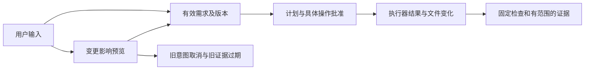

# Sprig 差异化调研与产品提案

调研日期 2026-10-02。Sprig 已加入会话锁、保守文件级撤销和[带版本的需求清单](tracked-requirements.md)。完整的影响预览和按需求撤回仍在规划中。

考虑到需求级撤回的实现难度，另有[其他产品方向调研](sprig-alternative-directions.md)，评估项目首次跑通、失败复现卡、编程陪练、轻量实验与小补丁模式。本文保留为较完整的长期设计参考，不代表必须按此路线实施。

## 结论

建议 Sprig 围绕一个明确的使用体验发展：**用户可以随时改变要求，已有修改、待执行操作和验收证据一起跟随需求变化。**

首个产品重点是“需求变更工作台”：用户说“取消数据库缓存，改成内存缓存；日志和我手动改的内容保留”，Sprig 在终端展示哪些要求替换了、哪些操作取消了、哪些修改可以撤回、哪些地方有冲突，以及哪些测试必须重跑。随后逐步加入终端交互验收和 Windows/WSL 对照验证。

这条路线符合 Sprig 已有的 Enter 发送、执行中引导、逐次确认、固定验收与原生 Windows 支持。调研发现其组成部分均有先例；在本次查看的官方材料中，未找到完整覆盖上述流程的内置产品体验。这是值得验证的组合与交互差异，不能据此声称“全行业首创”或“所有其他 agent 都没有”。

## 调研范围与证据边界

- 样本包括八个现行开源 agent 项目，以及一个已归档项目的交互设计；另查看若干专项工具和研究原型，主动寻找创新设想的反例。
- 材料以官方仓库、官方文档、实现源码和作者论文为主。文档与默认分支会变化，以下结论对应本次访问的资料，未固定到全部项目的 release 或 commit。
- 没有安装运行所有竞品，没有做同模型任务成功率、成本或性能排名。“文档提供”与“本地验证通过”是不同证据。
- 某项目的一行只列与本提案有关的已确认能力，省略不代表该项目没有其他功能；插件、自定义扩展与不同产品界面的能力也不能直接混为内置 CLI 能力。
- Sprig 当前行为依据本地源码与[既有验证记录](validation.md)。下面的路线不改变已有产品功能声明。

## 现有产品已经做到什么

| 项目 | 与 Sprig 有关的已确认能力 | 对差异化的影响及来源 |
| --- | --- | --- |
| Aider | 代码地图、Git 提交/撤销、编辑后 lint/test 与修复反馈 | 文件编辑、代码地图和自动测试属于共同基础。[官方仓库](https://github.com/Aider-AI/aider)、[lint/test](https://aider.chat/docs/usage/lint-test.html) |
| OpenCode | 终端界面、Build/Plan 模式；`/undo` 撤回最近用户消息之后的回复和文件修改，支持 `/redo`，文件撤回依赖 Git 仓库 | 全轮撤回已有成熟界面；Sprig 要解决的是一轮里部分需求变更后的处理。[官方仓库](https://github.com/anomalyco/opencode)、[TUI 文档](https://opencode.ai/docs/tui/) |
| Gemini CLI | 文件/命令工具、MCP、检查点；实验性执行中引导，Enter 后在下一模型轮采用 | 中途发送消息本身不新；该引导功能在所查文档中默认关闭。[官方仓库](https://github.com/google-gemini/gemini-cli)、[Model steering](https://geminicli.com/docs/cli/model-steering/) |
| Cline | 原生 TUI、Plan/Act、任务历史；检查点可分别恢复文件和对话；CLI/SDK/Kanban 的 agent teams | 不能把 Cline 描述为“只有 IDE 插件”，检查点和多 agent 已有先例。[TUI](https://docs.cline.bot/usage/tui)、[检查点](https://docs.cline.bot/core-workflows/checkpoints)、[Teams](https://docs.cline.bot/cli/agent-teams) |
| Goose | CLI/桌面界面、模型提供商与 MCP 扩展；可复用 recipes 打包工具、提示和设置 | 通用扩展与工作流模板不是独占创新。仓库已迁至 AAIF。[官方仓库](https://github.com/aaif-goose/goose)、[Recipes](https://goose-docs.ai/docs/guides/recipes/) |
| Codex CLI | 终端编程工作流、执行中引导、变更审查与扩展入口 | 插话和审查已有先例；这里比较开源 CLI，不把桌面/云产品的全部功能算入 CLI。[官方仓库](https://github.com/openai/codex)、[CLI 功能文档](https://learn.chatgpt.com/docs/codex/cli) |
| Pi | 终端 agent 与可扩展 agent 核心；steer/follow-up 队列、工具前后回调 | 当前核心文档描述本轮工具执行完后再注入 steering。Sprig 已有跳过未执行旧调用的行为，但队列概念本身不新。[Coding agent](https://github.com/earendil-works/pi/blob/main/packages/coding-agent/README.md)、[Agent 核心](https://github.com/earendil-works/pi/blob/main/packages/agent/README.md) |
| OpenHands SDK | agents、tools、conversations、workspaces 分层；本地/容器等工作空间、事件持久化与委派入口 | 会话事件、隔离工作空间和 agent 分工都有工程先例；SDK 与 CLI/UI 是不同项目。[官方 SDK](https://github.com/OpenHands/software-agent-sdk)、[会话状态源码](https://github.com/OpenHands/software-agent-sdk/blob/main/openhands-sdk/openhands/sdk/conversation/state.py) |
| Roo Code，已归档 | 可编辑/删除的 FIFO 消息队列；文档描述排队消息会隐式批准下一待处理动作 | 作为历史交互参考。Sprig 的新消息应调整要求，保留独立的操作批准语义。官方仓库标示 2026-05-15 归档。[仓库](https://github.com/RooCodeInc/Roo-Code)、[消息队列](https://roocodeinc.github.io/Roo-Code/features/message-queueing/) |

共同基础还包括会话恢复、上下文压缩、模型切换、工具接入、权限提示和代码审查。应按实际任务补齐这些能力，但不应把它们单独包装成 Sprig 的核心创新。

## 对“新功能”主动查反例

| 设想 | 已有先例 | 留给 Sprig 的空间 |
| --- | --- | --- |
| 总结说测试通过，程序核查证据 | [backcheck](https://github.com/VectorInstitute/backcheck) 根据会话记录检查无证据、修改后旧测试、测试范围等；当前适配 Claude Code，部分证据来自输出解析 | 由 Sprig 自己的工具直接产生结构化结果，并关联需求版本与实际文件状态；仍要承认证据不足和检查范围 |
| 只撤销 agent 的部分修改 | [agent-rollback](https://github.com/Nainish-Rai/agent-rollback) 已提供操作快照、按路径撤回和冲突处理 | 按需求展示影响，并在可证明归属的范围内撤回；文件级快照不能自动解决混在同一文件里的多个需求 |
| 记忆附来源，源文件变更后过期 | [agent-memoize](https://github.com/harlanwei/agent-memoize) 已记录源码指纹及 stale/fresh 等状态 | 可成为需求和证据系统的基础，不适合作为独立“首创”卖点 |
| 压缩时保留重要约束原文 | [Atomic compaction 文档](https://github.com/bastani-inc/atomic/blob/main/packages/coding-agent/docs/compaction.md) 已支持保留指定上下文范围 | 展示每条有效要求的来源与覆盖关系，验证压缩后仍能恢复；“不忘约束”已有先例 |
| 需求版本、状态和验收证据串联 | [AgentDirective](https://docs.agentdirective.org/) 有需求修订与证据追踪方法；[AppLooper](https://github.com/ZihongHe/applooper) 有版本候选及需求反馈/验证流程 | 在日常单 agent TUI 中处理临时变更，联动已有工作和过期证据；两者分别是方法资料和公开源码研究先例，不能直接证明竞品没有该能力 |
| agent 操作终端并回放测试 | [Microsoft tui-test](https://github.com/microsoft/tui-test) 提供终端操作与记录；[agent-tty](https://github.com/coder/agent-tty) 提供按键、快照和隔离会话；[agent-check](https://github.com/codeboltai/agent-check) 涵盖 TUI 测试计划 | 把用户要求、真实终端轨迹、断言和跨环境结果整合到同一任务；终端自动化工具本身不是新概念 |

AppLooper 的[许可证](https://github.com/ZihongHe/applooper/blob/main/LICENSE)含商业使用限制，故仅作为公开源码研究先例，不列入上表的开源 agent 产品样本。回滚也不能撤回邮件、远程服务或已完成命令的外部副作用；相关问题已有[执行编辑安全研究](https://arxiv.org/abs/2608.22928)，其[实现](https://github.com/eunomia-bpf/agent-check-restore-safety)明确属于研究原型。Sprig 不应把代码回滚宣传成任意操作可逆。

## 提案一：需求变更工作台

**优先级：最高，作为首个产品重点。**

用户在同一个输入框 Enter 发送：“不要 SQLite 缓存了，换成内存缓存；日志保留。”Sprig 将这次调整展示为一张可展开的变更卡：

```text
已接收调整，等待当前操作结束

替换：R2@1 SQLite 缓存 → R2@2 内存缓存
保留：R1 日志；R3 Windows 支持
取消：旧需求下尚未执行的建表命令
已有修改：cache.py 待审查；logging.py 保留
冲突：cache.py 含你后续的修改，需要审查
需重验：缓存测试；相关终端交互流程
```

模型可以建议拆分需求和影响关系，程序记录用户原文及版本；有歧义的映射标为待确认。用户明确提出的变更直接进入处理，只有歧义或需要批准的具体修改才要求审查。模型猜测的文件归属不能当成安全撤回的依据。

**第一版最小范围：**有效要求列表、原文来源、替换/追加关系、待执行意图取消、已有修改的影响预览和证据过期。优先把变更显示清楚，不在第一版承诺任意精细回滚。下一阶段再提供撤回：先支持未被后续修改的自有文件操作；冲突拒绝自动覆盖。更细的 hunk 撤回必须有明确归属与依赖分析，无法分离时保留现场并说明原因。

**与已有功能的区别：**消息队列解决“收到了什么”；检查点解决“回到哪一步”。这项提案还要回答“这条要求改变后，已经完成的工作如何处理”。OpenCode、Cline、Pi 和 agent-rollback 的相关能力是先例，需要在产品试验中验证这个额外流程是否值得使用。

**验收：**同一轮包含缓存、日志两个要求时，只取消缓存要求；保留日志和后续人工编辑；已失效的待执行命令不运行；撤回失败显示冲突；新请求不会批准旧 diff。正在运行的命令保留真实结果，取消并不宣称其副作用已撤回。

## 提案二：每条要求都有当前有效的交付证据

**优先级：与提案一一起落地。**

用户问：“刚才测试是绿色的，现在这个版本还算通过吗？”TUI 应显示每条要求的状态、检查范围及证据是否过期，点击即可查看真实命令与输出。

状态至少区分：待处理、已修改未验证、检查通过、检查失败、证据过期、无法判定。某条检查通过不自动代表整条需求已满足；摘要必须表达“哪些检查在什么条件下通过”。没有测试的要求也不能被模型的完成声明染成绿色。

**第一版最小范围：**证据绑定需求版本、检查定义、工作目录/文件清单内容摘要、运行环境、实际 argv、退出码、超时、输出截断及检查范围。采用保守的项目文件清单：纳入范围内的文件变化使证据过期；清单排除项可查看。首版不声称准确推导任意语言的测试依赖，也不声称本地文件摘要捕获了外部服务状态。

用户修改验收要求时，产生新版本并保留旧记录，沿用现有会话绑定约束，不能在原会话里无记录地替换固定 `--check`。这是需要新增的配置迁移流程，当前 Sprig 尚不支持。

对于修复类任务，优先记录同一检查在同一受控环境中“修改前失败、修改后通过”。新增功能、环境故障和非确定性测试不一定满足这个模式，要显示实际证据，不伪造失败基线。修改测试、减少测试范围、跳过测试与产品代码修复分别列出。

**与已有功能的区别：**backcheck 已处理“旧的绿色结果”问题；Sprig 的机会是把执行器直接生成的结果与需求变更工作台联动。当前固定验收循环是基础，还缺文件状态和需求版本绑定。

**验收：**测试后再次修改受检文件，旧绿色证据立即过期；检查命令改变后不能沿用旧结果；退出码未知、被取消或输出超限不报告通过；仅跑子集显示子集；测试范围缩减不会被当成修复的充分证明。

## 提案三：真实终端交互验收，附 Windows/WSL 差异报告

**优先级：第二阶段；先验证原生 Windows 技术可行性。**

这是一项新增工具能力。Sprig 自身的对话 TUI 仍是用户主入口；此提案进一步让 agent 能操作待开发的终端程序并留下验收记录。

示例要求：“打开我们的程序，输入中文多行，Enter 发送，运行中补发要求，然后取消；在 Windows 和 WSL 都检查。”结果包含按键/粘贴步骤、屏幕状态、实际消息历史或文件断言，以及每一步的成功或失败。检查的是用户真实操作到结果的链路。

**第一版最小范围：**启动受控 PTY 会话，发送按键与文本，读取有界屏幕快照，超时/取消清理，保存可回放轨迹；首先跑固定的 Sprig 自测夹具。允许 agent 探索并提出验收脚本，但最终验收采用固定步骤和断言，不能只依靠模型看截图说“正常”。秘密输入不进入可分享记录，批准范围包含将操作的具体进程。

双环境验证使用同一源代码版本、输入、终端尺寸、检查脚本和 `uv.lock`，各自建立 uv 环境和临时工作区，不共享 Windows/Linux 虚拟环境。结果分别记录 shell、Python、终端后端与环境差异；跨平台依赖解析可能不同，锁文件相同不代表环境完全相同。检测编码、CRLF、路径/大小写、按键或进程清理差异，根因不足时标为未定位。

**先例和选型约束：**Microsoft tui-test 文档支持 Windows/Linux/macOS，但项目处于 beta/重写阶段，采用前要实际验证 Python 接口及 ConPTY；agent-tty 将 Windows 标为 Tier 2、未在 CI 测试。当前 Sprig `run` 使用 `stdin=DEVNULL`，Textual Pilot 也不能代替外部程序的真实 PTY 交互。需要新增后端，不能仅改一条参数就声称完成。

**验收：**中文多行不丢失；Enter 只提交一次，换行快捷键确实换行；执行中消息顺序保留；取消后进程停止；确认窗关闭后输入焦点正确；Windows 与 WSL 的失败可分别复现。屏幕记录要配合断言，不能用像素相似度代替功能正确性。

## 提案四：模型与网关能力体检

**优先级：可独立小步交付，辅助 BYOK 用户；不作为“独有”宣传。**

用户提供的是网关地址和模型名，兼容声明不保证实际协议行为一致。Sprig 可以提供 `/doctor`，使用少量固定临时夹具检查普通回复、流式文本、function tools、工具参数分片、结束标记、断流处理、取消与用量字段。

报告给出“本次观察到支持 / 失败 / 未测”，记录端点、请求模型名、响应标识和检测时间。不能从响应中的模型名证明网关实际用了哪套权重；价格未知时不编造费用。联网体检由用户主动启动，展示请求数量；离线协议检查不调用模型。结果到期或配置变化后重测。

Sprig 已有 SSE 测试与真实 Agnes smoke 脚本，可将其中受控夹具提炼成产品诊断。先检查和提示，不自动切换端点、模型或改变任务的信任边界。

**验收：**兼容夹具通过；故意截断、错误工具片段和缺失结束事件有明确失败原因；失败响应的工具不会执行；报告和轨迹不包含测试密钥；未测能力不被写成支持。

## 后续探索：用实际结果比较两种方案

待事件与证据基础稳定后，可尝试 `/compare`：用户给两个实现方向，共用基线与验收定义，在两个隔离工作区依次试验，报告实际测试结果、行为差异、修改规模与有依据的成本，最后审查选中方案的 diff。

多 agent、worktree 和方案生成已有先例；这里的价值是假设、验收和结果可比较。先限制两个候选、固定预算，允许串行执行；不依赖模型投票，不把更多工具调用当成更好的方案。候选应用到用户目录前必须检查基线变化，遇到冲突保留现场。这项能力成本较高，排在首个产品重点之后。

## 与当前代码的衔接

| 已有基础 | 当前实现位置 | 提案需要补什么 |
| --- | --- | --- |
| 执行中输入与旧意图作废 | [`Agent._steer`](../src/sprig_agent/agent.py)、[`TaskInput` 和单 worker 队列](../src/sprig_agent/tui.py) | 需求 ID/版本、映射状态、影响卡与可编辑待处理列表 |
| 精确编辑、diff 确认、并发内容检查与撤销 | [`Tools`](../src/sprig_agent/tools.py)、[修改记录](../src/sprig_agent/changes.py)、[Windows 文件接口](../src/sprig_agent/windows.py) | 已有精确前后备份、恢复 diff 与外部变更拒绝；仍需需求归属与选择性撤回 |
| 用户固定验收与真实结果 | [`Agent._verify`](../src/sprig_agent/agent.py) 的验收流程、[验收测试](../tests/test_acceptance_chat.py) | 文件清单、需求版本、证据有效期、检查范围及配置迁移 |
| 原子会话保存、单写者锁、中断调用不重放 | [`SessionStore`](../src/sprig_agent/session.py) | 仍需版本化事件记录与需求归属；持久化修改备份已有中断状态，不自动重放 |
| Windows 进程清理与流式传输 | [`windows.py`](../src/sprig_agent/windows.py)、[`streaming.py`](../src/sprig_agent/streaming.py) | PTY 会话管理；取消网络/命令不等于终端按键驱动 |
| uv 与 Windows/WSL 验证 | [`uv.lock`](../uv.lock)、[验证记录](validation.md) | 隔离夹具、双环境同版本任务与差异报告 |

实施前应保持 Python 核心/工具/TUI 的现有边界。新增终端依赖由 uv 管理与锁定；应先验证原生 Windows 支持，再决定使用哪一个现有库。

建议引入可版本化的事件记录，由会话单写者按序持久化，保存在现有工作目录外的私有会话目录。事件示例：用户输入、需求变更、工具意图、批准、工具结果、文件变化、检查结果和证据过期。记录携带稳定事件 ID，文本脱敏和大小限制沿用现有边界；不可把模型声称的执行结果当成真实工具事件。



批准关联具体操作参数、当时需求版本和文件前置状态。用户批准过的范围可以复用，前提是参数和依据仍有效；需求变化导致旧依据失效时，既有批准不能自动转移给另一操作。用户新消息保持独立的输入语义。

程序崩溃在“工具意图已写入、结果未写入”之间时，只能记录结果未知并检查现场，不重放未知副作用。单写者锁、事件顺序与恢复测试应先完成，否则无法可靠解释需求和文件之间的关系。

## 推荐实施顺序

| 阶段 | 具体交付 | 完成后用户可以做什么 |
| --- | --- | --- |
| 0：记录基础 | 会话单写者锁、事件 ID、工具前后状态与崩溃恢复 | 恢复后知道哪些操作确定完成、哪些结果未知 |
| 1：首个可用闭环 | 有效需求列表、执行中变更卡、取消旧意图、证据绑定及过期 | 随时改要求，并看清对当前任务与验收的影响 |
| 2：需求撤回 | 可审查的自有修改撤回，先保守文件级、再按可靠归属细分 | 保留仍需要的工作和人工修改，冲突可解释 |
| 3：终端与双环境 | PTY 固定交互脚本、回放、Windows/WSL 同版本对照 | 验收真实终端使用流程并定位跨环境问题 |
| 可独立推进 | 有限请求的模型/网关体检 | 在接入新服务前了解已验证的协议能力 |
| 后续试验 | 两方案隔离比较、来源绑定记忆与可审计压缩 | 在明确范围和预算内比较方案、继续长任务 |

阶段 1 已支持显式命名、替换和撤回要求，保留原始消息位置。执行中变更会使尚未执行的旧操作失效，并使该任务此前的验收过期。逐项检查关联和文件影响预览仍待实现。

MCP、更多语言索引、容器及常规工具能力根据任务需求补齐。完整多 agent 系统和泛化长期记忆会增加状态与成本，应在上述单任务体验得到验证后再扩展。

## 如何验证这条路线确实有价值

先对“当前 Sprig”和“提案实现”使用相同临时项目、需求序列、人工编辑时机与固定检查。以可控制的脚本 provider 重放竞态，保证失败可以复现；再用同一真实模型进行有限试验，记录样本数、失败和费用，不从一次成功推导普遍优势。

| 场景 | 必须观察的结果 |
| --- | --- |
| 模型输出中追加要求 | 消息不丢失；旧响应提出的无效操作未执行 |
| 运行命令时改要求 | 已执行操作有真实结果或明确未知状态；剩余旧意图取消 |
| 确认窗中调整要求 | 旧 diff 作废；新消息不等于批准 |
| 同一轮取消部分要求 | 其他要求与其修改仍保留；依赖不明处显示未知 |
| agent 修改后用户手改同一文件 | 用户修改不被静默覆盖；无法分离时显示冲突 |
| 测试通过后再改代码 | 原证据过期；重新检查后才显示该范围通过 |
| 验收定义变更/测试缩减 | 保留版本与范围差异；旧结果不迁移为新通过 |
| 崩溃、取消、恢复及两进程竞争 | 不重放未知副作用；不覆盖同一会话历史 |
| 中文、多行、Enter、执行中追加和取消 | 真实终端轨迹与消息/进程断言一致 |
| Windows/WSL、相同代码和锁文件 | 两边分别有结果；平台相关失败能够复现 |

核心指标是有效要求覆盖率、旧意图误执行次数、无关/人工修改误覆盖次数、过期证据误报次数、变更后的额外返工和用户审查负担。对确定性夹具，旧意图误执行、人工修改误覆盖和过期证据误报应为零；这些测试不构成所有任意命令或外部副作用的安全证明。用户体验还需观察实际试用，不能仅由测试数量或 agent 数量推断。

后续实现已补上会话独占锁、管理入口、上下文预算、可预览的确定性压缩、保守文件级撤销与重做，以及撤销后的验收失效提示。完整需求工作台、精细需求归属撤回、证据版本化、PTY 工具和模型体检仍待实现。已有功能及其验证范围以 [README](../README.md) 和[验证记录](validation.md)为准。
